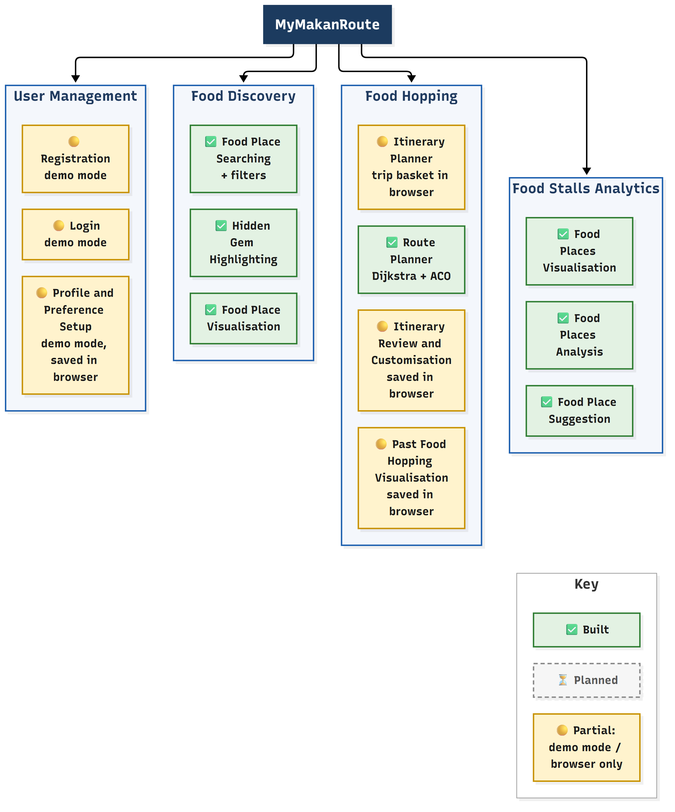

# MyMakanRoute: Feasibility Report

Final year project CAT405, Danial Hakim bin Kamal Azwa. Supervisor: Dr. Zarul Fitri Zaaba.
Prepared for the supervisor meeting on **Friday 6 Nov 2026, 2:30 pm**.

All numbers below come from one run of `npm run feasibility` (in `backend/`) on 5 Nov 2026 against the project database, at commit `22a1ee8` plus uncommitted work. The raw output is `docs/feasibility-results.json`; the script that produced it is `backend/scripts/feasibility.js`. The script reuses the real module code (hidden gem rule, search, Dijkstra, ACO, analytics) and only reads from the database. The whole run took 2.1 s.

> **Important:** the ratings and review counts of the 55 SAMPLE places are **invented**. Every result based on ratings shows that the method works. It says nothing about real food places.

## Summary

- **Feasible: the route planner.** It builds a real walking-time matrix on an OpenStreetMap road graph with 26,689 nodes. Over 40 random trips of 4 to 10 stops, the improved ACO matched the exact optimum in 39 (97.5%), including 19 of 20 at 8–10 stops, where nearest neighbour found the best order in only 3 of 20. These results are indicative (10 trips per size, one ACO seed). Planning one trip takes milliseconds: a 10-stop matrix took 46 ms and the improved ACO 7 ms on average.
- **Feasible: discovery with hidden gem highlighting.** The radius search with filters runs on PostGIS. The three-label rule (Hidden Gem / Popular / no label) labels and ranks places as designed, with gems first (Komtar example below).
- **Feasible: the analytics overview.** Totals, groupings and written findings are produced from the same data. They rest on sample ratings for now.
- **Partial: user accounts and saved trips.** The web screens for registration, login, profile, saving trips and past trips work in demo mode, with data kept in the browser. The database tables exist. Supabase Auth and the itinerary API are planned for Phase 2B.
- **Main risk: real ratings.** OpenStreetMap has no ratings at all (0% of 1,186 places), only 2.3% have a halal tag, and 23.2% have opening hours. The hidden gem idea depends on ratings, so real ratings must come from elsewhere. The plan is Google Places for the 55 sample places (step 2.9a) and user ratings later.

Diagrams: [architecture](architecture.md), [database ERD](erd.md), [use cases](use-case.md), [module status](module-status.md). PNG versions are in `docs/diagrams/`.

## Terms used

- **PostGIS:** an add-on for PostgreSQL that handles map coordinates, e.g. "places within 1.5 km of Komtar".
- **Road graph:** roads stored as **nodes** (junctions and road ends) and **edges** (road pieces with a length and travel time).
- **Dijkstra's algorithm:** finds the quickest path between two nodes of a graph. We use it to build a **time matrix**, the walking time between every pair of chosen places.
- **Visiting order problem:** given the time matrix, find the order of stops with the smallest total time. Our routes are **open**: they start at the first chosen stop and do not return. This is a small travelling salesman problem.
- **Brute force:** try every possible order. It is always optimal, but there are (n−1)! orders for n stops. Our version cuts a branch as soon as it is already slower than the best order found ("pruning").
- **Nearest neighbour:** a greedy method that always walks to the closest unvisited stop. It is very fast but often not optimal.
- **Ant Colony Optimisation (ACO):** many simulated "ants" build orders at random. Each ant prefers stops that are close and moves that carry more "pheromone". Short orders deposit more pheromone, so the colony converges on a short order. ACO is a heuristic: it is usually, but not always, optimal.
- **Optimality gap:** how much longer a method's route is than the optimum, as a percentage: (method − optimum) / optimum × 100. **Opt%** is the share of trips where the method found the optimum.

## What was tested and how

**Data in the database: 1,241 places.** These are the 1,241 named OSM places: 1,186 stored as `source = 'osm'` plus 55 of the same places kept as SAMPLE rows with invented ratings.
- 1,186 come from OpenStreetMap (`source = 'osm'`; Gelugor/USM to George Town, bounding box 5.33–5.46 N, 100.27–100.345 E).
- 55 are SAMPLE places (`source = 'sample'`, `is_sample = true`). Their names and positions are real OSM places; their rating, review count, price, halal flag, opening hours and dietary tags are invented.
- The raw OSM snapshot has 1,298 elements, of which 1,241 (95.6%) have a name. Unnamed elements are not imported.

**Road graph.** It was built by `npm run build:road-graph` from the OSM road network of the same bounding box on 3 Nov 2026. See Result 3.

**Route benchmark method.**
- **Travel mode and sizes:** walking, trip sizes n = 4, 6, 8, 10, with **10 trials per size**.
- **Trip selection:** each trial picks a random start place, plus n−1 random places among its 2n nearest. Places come from a pool of 42 sample places in George Town, Pulau Tikus, Jelutong and Gurney.
- **Repeatability:** the trip selection is seeded (seed 2026 + n), and every ACO run uses seed 42, so the same command gives the same trips and results.
- **Methods run on the same Dijkstra matrix:**
  - improved ACO (the API default)
  - textbook ACO: the plain Ant System pheromone update (no elitist deposit, no pheromone limits, β = 3, within the usual 2–5 range); all other settings identical to the improved version (same ants, iterations, early stop, seed)
  - nearest neighbour
  - brute force, the exact optimum and **ground truth**, raised to 10 stops for this study only (the API limits it to 8)
- **Data quality:** all 40 trials were usable. No stop was unreachable, and every trial has a brute-force optimum.

## Result 1: Data availability (OpenStreetMap vs sample)

| Source | Places | Named | Cuisine | Opening hours | Halal tag | Rating |
| --- | ---: | ---: | ---: | ---: | ---: | ---: |
| OpenStreetMap | 1,186 | 100% | 45.4% | 23.2% | **2.3%** | **0%** |
| SAMPLE (invented values) | 55 | 100% | 100% | 100% | 100% | 100% |

**Finding.** OpenStreetMap is good for **where** places are (names, positions, roads). It is weak on **what** they are like.
- It has no ratings or review counts at all, so the hidden gem rule cannot run on OSM data alone.
- Only 2.3% of places say whether they are halal, so a "halal only" filter on OSM data would hide most halal places.

This is why the 55 SAMPLE places exist: they let us test the method now, and they are clearly marked in the database, the API (`isSample`) and the web app.

**Plan.**
1. Step 2.9a: look up the 55 sample places in the Google Places API and store real ratings and review counts. A place is accepted only if the names are similar and the positions are within about 100 m. The match rate will be reported.
2. Later: ratings from MyMakanRoute users.

## Result 2: Hidden gem rule

The rule (`food-discovery/hiddenGem.js`, thresholds from config):

- **Hidden Gem:** rating ≥ 4.3 **and** 1–100 reviews ("well liked but not many people know it yet").
- **Popular:** more than 100 reviews, whatever the rating.
- **No label:** everything else, including places with no rating.

On the 55 sample places: **14 Hidden Gems, 35 Popular, 6 no label.**

Top gems (sample ratings):

| Place | Area | Rating | Reviews |
| --- | --- | ---: | ---: |
| Ali Bubur Kacang (Mung Bean Sweet Porridge) | George Town | 4.7 | 29 |
| Sister Yao's Char Koay Kak | George Town | 4.6 | 48 |
| He and She Coffee | Gelugor | 4.6 | 81 |
| VR Pinxin Vegan | George Town | 4.6 | 95 |
| Li Er Nyonya Cafe | Pulau Tikus | 4.5 | 34 |
| Tok Tok Mee Bamboo Noodles | George Town | 4.5 | 37 |
| Muscle Man Char Koay Kak | George Town | 4.5 | 71 |

**Sensitivity:** how many of the 55 sample places become Hidden Gems under other thresholds.

| Min rating \ Max reviews | ≤ 50 | ≤ 100 | ≤ 200 |
| --- | ---: | ---: | ---: |
| 4.0 | 6 | 16 | 16 |
| **4.3** (current) | 6 | **14** | 14 |
| 4.5 | 4 | 7 | 7 |

The columns "≤ 100" and "≤ 200" are identical because **no sample place has 101–200 reviews**. That is a gap in the sample data, not a property of the rule. The sample set should get a few places in that band so the review threshold can be tested properly. Real Google review counts (2.9a) will show where the threshold should sit.

**Search example: 1.5 km around Komtar** (`GET /api/discovery/places`).
- **All places:** 704 found (7 Hidden Gem, 19 Popular, 678 no label; most are OSM places without ratings). The top 5 are all Hidden Gems, nearest first:

| # | Place | Label | Rating / reviews | Distance |
| ---: | --- | --- | --- | ---: |
| 1 | Sister Yao's Char Koay Kak | Hidden Gem | 4.6 / 48 | 275 m |
| 2 | Muscle Man Char Koay Kak | Hidden Gem | 4.5 / 71 | 394 m |
| 3 | VR Pinxin Vegan | Hidden Gem | 4.6 / 95 | 489 m |
| 4 | Hot Bowl White Curry Mee | Hidden Gem | 4.4 / 92 | 649 m |
| 5 | Tok Tok Mee Bamboo Noodles | Hidden Gem | 4.5 / 37 | 736 m |

- **Halal only:** 17 found (2 Hidden Gem, 4 Popular, 11 no label). The two gems come first even though they are further away (Ali Bubur Kacang at 1,137 m, Restoran Nasi Dalcha Kassim Mustafa at 1,140 m). Popular places follow, e.g. Penang Road Famous Laksa at 322 m. The ranking works as designed. The small count shows the halal data problem from Result 1: only places explicitly tagged halal pass the filter.

## Result 3: Route planner

**Road graph** (`data/road-graph-penang.json`, about 2.5 MB, loaded in 201 ms):

| | Value |
| --- | ---: |
| Nodes / edges | 26,689 / 34,732 |
| Walking: usable nodes, largest connected part | 26,478; 26,208 (99% of usable) |
| Driving: usable nodes, largest connected part | 23,448; 22,918 (97.7% of usable) |

Almost the whole walkable network is connected, so places can be reached once they are snapped to their nearest road node.

**Benchmark** (walking, 10 trials per size, brute force = optimum; times are averages per trip). *Indicative only: 10 trips per size and one ACO seed. A larger evaluation (50+ trips, several seeds, 12–20 stops) is planned.*

| Stops | Optimum (min) | Dijkstra matrix (ms) | Improved ACO opt% / avg gap / max gap / ms | Textbook ACO opt% / avg gap / max gap / ms | Nearest neighbour opt% / avg gap | Brute force (ms) |
| ---: | ---: | ---: | --- | --- | --- | ---: |
| 4 | 22.5 | 5.84 | 100% / 0% / 0% / 1.74 | 100% / 0% / 0% / 1.69 | 90% / 1.04% | 0.05 |
| 6 | 30.1 | 9.91 | 100% / 0% / 0% / 1.40 | 100% / 0% / 0% / 2.92 | 70% / 1.52% | 0.04 |
| 8 | 50.6 | 18.43 | **100% / 0% / 0%** / 3.16 | 60% / 0.65% / 2.67% / 5.35 | 10% / 9.21% | 0.13 |
| 10 | 62.6 | 45.71 | **90% / 0.2% / 2.03%** / 7.26 | 70% / 1.0% / 4.48% / 14.88 | 20% / 9.14% | 2.90 |

Nearest neighbour takes about 0.01 ms in every size. Run times are single-run millisecond values and vary by about ±2×; they show both are fast enough, not which is faster. (A 50-trial run is possible with `npm run feasibility -- --trials=50` but is not part of these results.)

**Worked example: a 6-stop walking trip in George Town** (improved ACO order, which here equals the brute-force optimum). It was chosen as the first 6-stop trip where nearest neighbour is not optimal, to illustrate a difference; on average nearest neighbour is only 1.5% longer at 6 stops.

| Leg | From → To | Time | Distance |
| ---: | --- | ---: | ---: |
| 1 | Tok Tok Mee Bamboo Noodles → Tho Yuen Dim Sum | 3.1 min | 257 m |
| 2 | Tho Yuen Dim Sum → Hameediyah Tandoori House | 1.5 min | 122 m |
| 3 | Hameediyah Tandoori House → Toh Soon Cafe | 1.3 min | 110 m |
| 4 | Toh Soon Cafe → Chulia Street Night Hawker Stalls | 7.2 min | 609 m |
| 5 | Chulia Street Night Hawker Stalls → Ali Bubur Kacang | 4.8 min | 407 m |
| | **Total** | **17.9 min** | **1,505 m** |

Optimum 17.9 min; improved and textbook ACO both 17.9 min; nearest neighbour 19.3 min (about 8% longer).

**Discussion.**

- **Improved ACO vs textbook.** Both are based on the Ant System (Dorigo, Maniezzo & Colorni, 1996). The textbook variant uses the plain Ant System pheromone update. The improved ACO adds two ideas:
  - an **elitist deposit**: extra pheromone on the best order found so far;
  - **MAX-MIN pheromone limits**: pheromone is kept between a lower and an upper bound, so the ants keep exploring.

  It also uses heuristic weight β = 2 instead of 3; all other settings are identical. Both versions are equal at 4–6 stops (both always optimal). At 8 and 10 stops the improved version finds the optimum more often (100% vs 60%, 90% vs 70%) and has smaller gaps (worst case 2.03% vs 4.48%). Run times are single-run millisecond values and vary by about ±2×; they show both are fast enough, not which is faster.
- **Nearest neighbour** is fine for 4 stops but about 9% longer than optimal at 8–10 stops (optimal in only 10–20% of trips).
- **Honest point: brute force is faster here.** For ≤ 10 stops, brute force with pruning is both exact and faster (2.9 ms vs 7.26 ms at 10 stops), which is why it serves as ground truth. ACO is justified by **scalability**, because the number of orders grows as (n−1)!:
  - 10 stops: 9! = 362,880 orders
  - 13 stops: 12! = 479,001,600 orders
  - 15 stops: 14! ≈ 87 billion orders

  Pruning helps but does not remove this growth. ACO's cost grows only polynomially (ants × iterations × n²). ACO is also the Intelligent Computing component of the project.
- **Future evaluation** should test 12–20 stops and multi-day trips, where brute force is no longer practical. There ACO can be compared with nearest neighbour and, as a possible additional baseline (suggestion), nearest neighbour plus 2-opt (a simple local improvement method).

> **ACO settings decision (student to confirm).** Keep the improved settings as the API default: 200 iterations, α = 1, β = 2, evaporation ρ = 0.5, q = 1, ants = max(10, 2n), elitist deposit on, MAX-MIN limits on (τmin = 0.2 × τmax), stop after 100 rounds without improvement, seed 42. Keep the textbook settings only as the comparison baseline. Reason (solution quality only): equal at 4–6 stops (both optimal), higher optimum rate and smaller gaps at 8–10 stops. Run times are not used for this decision because they are single-run values that vary by about ±2×. Indicative only: 10 trips per size and one ACO seed. A larger evaluation (50+ trips, several seeds, 12–20 stops) is planned.

## Result 4: Analytics overview (sample ratings)

`GET /api/analytics/overview` on the 55 rated places (all SAMPLE):
- 14 Hidden Gems, 35 Popular, 6 unlabelled.
- Average rating 4.18.
- 20 halal places (36%).
- Top areas by average rating: George Town 4.23 (28 places), Pulau Tikus 4.22 (6), Bayan Lepas 4.18 (4).

Findings sentences generated by the backend:

1. George Town has the highest average rating (4.2) among areas with at least 3 rated places.
2. "cafe" is the best rated cuisine (4.4) among cuisines with at least 3 rated places.
3. 14 of 55 rated places (25%) are Hidden Gems: rated 4.3 or higher with 100 reviews or fewer.
4. Hidden Gems average 4.5 stars from about 66 reviews each, while Popular places average 4.2 stars from about 1226 reviews.
5. 36% of rated places (20 of 55) are marked halal.

These show that the pipeline works. Because the ratings are invented, the findings are **not** claims about Penang food.

## Module status



| Status | Count | Submodules |
| --- | ---: | --- |
| ✅ Built (API + web page + tests) | 7 | Food Place Searching, Hidden Gem Highlighting, Food Place Visualisation, Route Planner, Food Places Visualisation, Food Places Analysis, Food Place Suggestion |
| 🟡 Partial | 6 | Registration, Login, Profile and Preference Setup, Itinerary Planner, Itinerary Review and Customisation, Past Food Hopping Visualisation |

"Partial" means the web screen works, but only in **demo mode** or with data **saved in the browser** (localStorage). The backend part (Supabase Auth, itinerary API) is planned for Phase 2B; its database tables already exist. Details and evidence: [module-status.md](module-status.md).

## Limitations and risks

| Item | Effect | Plan |
| --- | --- | --- |
| Sample ratings are invented | Hidden gem and analytics results show the method only | Google Places ratings for the 55 (2.9a); user ratings later |
| Halal tags in OSM: 2.3% | The halal filter misses untagged halal places | Google data, manual checks, user reports; show "halal unknown" honestly |
| Demo-mode login (password not checked, browser only) | No real accounts yet | Supabase Auth through our backend (2B) |
| Trips saved in the browser only | Lost if the browser storage is cleared; not shared across devices | Itinerary API on existing tables (2B) |
| Walking speed fixed at 1.4 m/s (about 5 km/h); driving speeds per road type are assumptions | Times are estimates, no traffic, crossings or waiting | State it in the UI; compare a few legs with a map service |
| Each place is snapped to its nearest road node | Small error at the start and end of each leg; a place near a highway may snap to the wrong road | Report the snap distance (already in the API); snap to a road segment later |
| Overpass (OSM download) can be busy | Imports may fail | Snapshots are saved in `data/`; scripts retry several servers |
| Supabase free tier pauses an idle project | Demo could fail | Open the dashboard before the meeting |
| No CI (automatic tests on GitHub) yet | Mistakes are caught later | GitHub Actions in Phase 3 |
| Landing-page food photos supplied by the student | Licence not confirmed | Confirm before any public release |

## Next steps

1. **Step 2.9a, Google ratings for the 55 sample places**, with the match rate reported (about 1–2 days after the meeting).
2. **Phase 2B, Supabase Auth** (register, login, refresh, profile and preferences) and the **itinerary API** (save, edit, past trips) on the existing tables (proposed: about 11–20 Nov).
3. **Restyle the remaining web pages** to match the new landing page (after the student's feedback).
4. **Mobile app** (React Native + Expo) using the same API (proposed: late Nov to early Dec).
5. **GitHub Actions CI** with a PostGIS test database (Phase 3).
6. **Larger ACO evaluation:** 12–20 stops, multi-day trips, 50+ trials per size, several seeds; a 2-opt baseline is a possible addition (Phase 3).

## Reproduce

```
cd backend
npm.cmd install
npm.cmd run db:migrate
npm.cmd run db:seed            # 55 SAMPLE places
npm.cmd run import:osm         # OpenStreetMap places
npm.cmd run build:road-graph   # only if data/road-graph-penang.json is missing
npm.cmd run feasibility        # prints the tables and writes docs/feasibility-results.json
npm.cmd run feasibility -- --trials=50   # optional bigger benchmark
```

The benchmark is seeded, so the same database and code give the same numbers. Timings (ms) depend on the computer.
