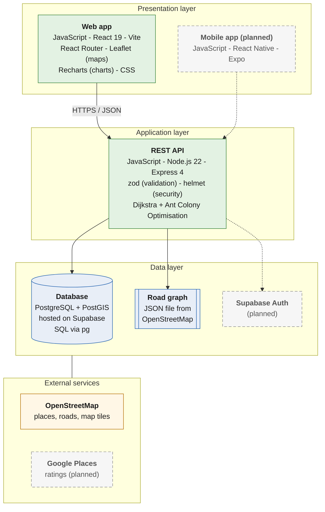
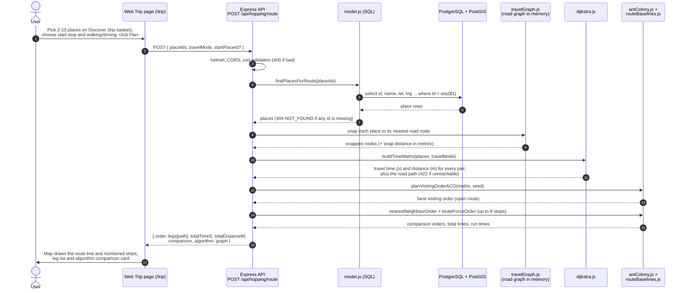

# MyMakanRoute: Architecture

How the parts of MyMakanRoute fit together, as of 5 Nov 2026 (branch `feature/feasibility-core`).
Solid boxes and lines are **built**. Dashed boxes and lines are **planned** (not built yet).

Terms used on this page:

- **Client:** the app the user sees (web page or phone app). It asks the server for data.
- **REST API:** the backend's list of web addresses (endpoints, e.g. `GET /api/discovery/places`) that clients call. Answers are JSON (structured text).
- **Middleware:** a small step every request passes through before it reaches the module code (for example a security check).
- **PostGIS:** an add-on for PostgreSQL that understands map coordinates, so the database can answer "which places are within 1.5 km?".
- **OSM (OpenStreetMap):** a free, community-made world map. We use its food places and its roads.

## 1. System architecture (languages and tech stack)



| Layer | Language | Tech stack |
| --- | --- | --- |
| Presentation (web) | JavaScript, CSS | React 19, Vite, React Router, Leaflet, Recharts |
| Presentation (mobile, planned) | JavaScript | React Native, Expo |
| Application (backend API) | JavaScript | Node.js 22, Express 4, zod, helmet; own Dijkstra and ACO code |
| Data | SQL | PostgreSQL + PostGIS on Supabase (via `pg`); road graph JSON |
| Authentication (planned) | | Supabase Auth |
| External data | | OpenStreetMap (places, roads, map tiles); Google Places ratings (planned) |
| Development tools | | Git + GitHub, ESLint, Prettier, Jest + Supertest (backend tests), Vitest (web tests) |

Solid boxes are built; dashed boxes are planned.

## 2. Sequence: "Plan a food hop"

A **sequence diagram** shows who talks to whom, in time order (top to bottom).



**In plain words**

1. The user adds places to a **trip basket** on the Discover page (kept in the browser), then opens the Trip page and clicks Plan.
2. The API checks the request (2 to 10 different place ids, travel mode, optional start).
3. The model loads the places from the database.
4. Each place is **snapped** to the nearest point on the road graph (a place is rarely exactly on a road).
5. **Dijkstra** (a classic shortest-path algorithm) finds the quickest road path between every pair of places. This gives a **time matrix** (a table: "from A to B takes N seconds").
6. **Ant Colony Optimisation (ACO)** (many simulated "ants" try visiting orders; good orders leave more "pheromone" so later ants prefer them) picks the visiting order. It uses a fixed **seed** (starting value for the random numbers), so the same input gives the same answer.
7. For comparison, the API also runs **nearest neighbour** (always go to the closest unvisited place) and **brute force** (try every order; only up to 8 stops because it gets slow).
8. The web page draws the route on the map and shows the comparison. Saving the trip is done in the browser for now (the itinerary API is planned for Phase 2B).

## 3. Layers and folders

Each module follows the same four layers, so a request always travels the same way:

| Layer | File | Job | Example (Food Hopping) |
| --- | --- | --- | --- |
| Routes | `routes.js` | Lists the URLs and their zod input checks | `POST /route` with `planRouteSchema` |
| Controller | `controller.js` | Reads the request, calls the service, sends the response with `success()` | `planRouteHandler` |
| Service | `service.js` (+ logic files) | The actual logic, no HTTP and no SQL | `planRoute()` using `dijkstra.js`, `antColony.js`, `routeBaselines.js`, `travelGraph.js` |
| Model | `model.js` | SQL queries only (parameterised) | `findPlacesForRoute()` |

Built endpoints (all answer `{ success: true, data }`):

| Method and path | Module, submodule |
| --- | --- |
| `GET /health`, `GET /health/db` | (shared) server and database check |
| `GET /api/discovery/places?lat&lng&radius&halal&maxPrice&cuisine&dietary&openNow&label&limit` | Food Discovery: Food Place Searching + Hidden Gem Highlighting |
| `GET /api/discovery/places/:id` | Food Discovery: Food Place Visualisation (detail panel) |
| `POST /api/hopping/route` | Food Hopping: Route Planner |
| `GET /api/analytics/overview` | Food Stalls Analytics: all three submodules |

Folder structure (main parts only):

```
MyMakanRoute/
  backend/
    src/
      app.js                 builds the Express app (tests import it)
      index.js               starts the server (only file that calls listen)
      config/                index.js reads .env; loadConfig.js checks values with zod
      lib/                   db.js (pg connection pool), response.js (success, AppError, asyncHandler)
      middleware/            validate.js, errorHandler.js, notFound.js
      modules/
        food-discovery/      routes, controller, service, model + hiddenGem.js, openingHours.js
        food-hopping/        routes, controller, service, model + travelGraph.js, dijkstra.js,
                             antColony.js, routeBaselines.js
        food-stalls-analytics/ routes, controller, service, model + findings.js
        user-management/     empty (planned, Phase 2B)
    db/
      migrations/            001_places.sql ... 004_lock_down_public_api.sql
      seeds/                 sample-places.json (55 SAMPLE places) + seed.js
      migrate.js             tiny migration runner
    scripts/                 import-osm.js, build-road-graph.js, feasibility.js
    tests/                   unit/ and api/ (Jest + Supertest, no database needed)
  web/
    src/
      App.jsx                page routes
      api/                   client.js + one file per module (foodDiscovery, foodHopping,
                             foodStallsAnalytics, userManagement)
      pages/                 one page per submodule group (Discover, Trip, Trips, Analytics,
                             Login, Register, Profile, Home)
      components/, context/, hooks/, lib/
  mobile/                    empty (planned, Phase 2D)
  data/                      osm-penang.json (OSM places), road-graph-penang.json (OSM roads)
  docs/                      PLAN.md, FEASIBILITY.md, architecture.md, erd.md, use-case.md, module-status.md
```

Web pages and their routes: `/` landing page, `/discover` Food Discovery, `/trip` Itinerary Planner + Route Planner + Itinerary Review and Customisation, `/trips` Past Food Hopping Visualisation, `/analytics` Food Stalls Analytics, `/login`, `/register`, `/profile` User Management (demo mode).

Images for slides: `docs/diagrams/architecture-1.png` (system architecture) and `docs/diagrams/architecture-2.png` (sequence diagram), made with mermaid-cli from the diagrams above.
