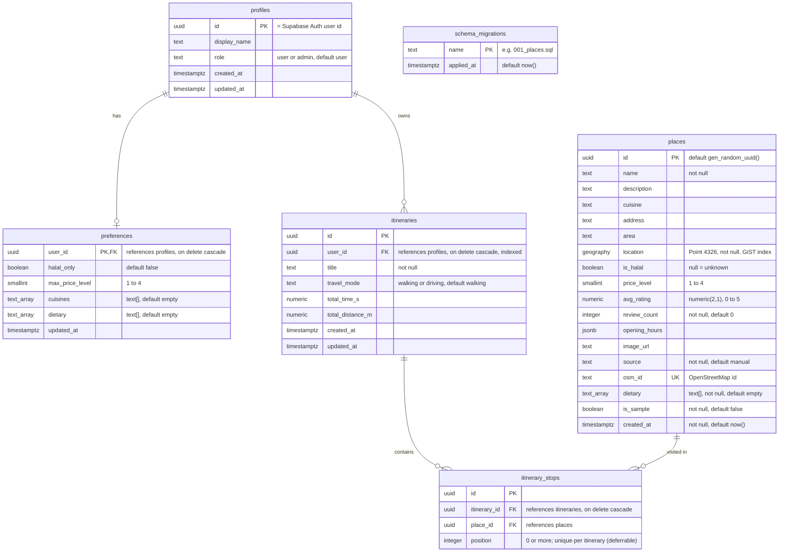

# MyMakanRoute: Database (ERD)

An **ERD** (Entity Relationship Diagram) shows the database tables, their columns and how the tables link to each other. This one is drawn from the real migration files `backend/db/migrations/001_places.sql` to `004_lock_down_public_api.sql` and the runner `backend/db/migrate.js` (which creates `schema_migrations`).

Terms:

- **PK (primary key):** the column that identifies each row uniquely.
- **FK (foreign key):** a column that points to the primary key of another table.
- **UK (unique key):** a column whose values may not repeat.
- **uuid:** a long random id such as `3f2a...`; **timestamptz:** a date and time with time zone; **jsonb:** structured JSON data; **text[]:** a list of texts.

## Diagram

How to read the lines: `||--o|` means one to zero-or-one, i.e. a 1-to-1 link (each profile has at most one preferences row, because `preferences.user_id` is both the primary key and the foreign key). `||--o{` means one to zero-or-many (one profile owns many itineraries; one itinerary has many stops; one place can appear in many stops). `schema_migrations` stands alone: it only records which migration files have been applied. In Mermaid, `text_array` stands for PostgreSQL `text[]`.

## Notes

- **Which tables the API uses today.** Only `places` is read by the API (Food Discovery, Food Hopping, Food Stalls Analytics). `profiles`, `preferences`, `itineraries` and `itinerary_stops` **exist in the database but are not used by the API yet**; they are for Phase 2B (Supabase Auth login, saved itineraries). Until then the web app keeps the demo user, preferences and saved trips in the browser (localStorage).
- **profiles.id = the Supabase Auth user id.** There is deliberately **no foreign key to Supabase's `auth.users` table**, so the same migrations also run on a plain PostgreSQL database (a laptop or a CI test server, where `auth.users` does not exist).
- **location** is a PostGIS `geography(Point, 4326)`: a longitude/latitude point on the Earth (4326 is the standard GPS coordinate system). A **GiST index** (a spatial index) makes "places within N metres" searches fast.
- **Sample data.** The 55 seed places have real names and coordinates from OSM, but these columns are **invented** when `is_sample = true` (and `source = 'sample'`): `avg_rating`, `review_count`, `price_level`, `is_halal`, `opening_hours`, `dietary`. They are for testing only and are not real reviews. Places imported from OSM have `source = 'osm'`, no ratings and usually no halal tag.
- **itinerary_stops.position** is unique per itinerary, but the check is **deferrable** (checked at the end of a transaction), so stops can be reordered without a temporary clash.

## Data dictionary: `places`

| Column | Type | Meaning |
| --- | --- | --- |
| id | uuid, PK | Unique id of the place |
| name | text, required | Place name |
| description | text | Short description (optional) |
| cuisine | text | Cuisine, e.g. "nasi kandar" or "indian". The cuisine filter matches text contained in it |
| address | text | Street address |
| area | text | Area or neighbourhood, e.g. "George Town" (used for analytics grouping) |
| location | geography(Point, 4326), required | Position on the map (longitude, latitude) |
| is_halal | boolean | true / false / null (unknown). The halal filter keeps only `true` |
| price_level | smallint 1 to 4 | 1 = cheap ... 4 = expensive. The budget filter keeps `price_level <= maxPrice` |
| avg_rating | numeric(2,1), 0 to 5 | Average star rating. Sample places: invented. OSM places: empty |
| review_count | integer >= 0, default 0 | Number of reviews. Used with avg_rating by the hidden gem rule |
| opening_hours | jsonb | `{"mon":[["08:00","15:00"]], ...}`; the raw OSM text, if any, is kept under `"osm"`. Used by the "open now" filter |
| image_url | text | Photo link (optional) |
| source | text, default 'manual' | Where the row came from: `sample`, `osm` or `manual` |
| osm_id | text, unique | OpenStreetMap id; lets the import scripts update instead of duplicate |
| dietary | text[], default empty | Tags such as `vegetarian`. The dietary filter needs all chosen tags |
| is_sample | boolean, default false | true = SAMPLE row with invented values |
| created_at | timestamptz | When the row was added |

## Database function and security

Migration 001 also creates a function **`nearby_places(lat, lng, radius_m default 2000)`** that returns the places within `radius_m` metres of a point, nearest first, with their distance. (The current Food Discovery search writes its own similar query in `food-discovery/model.js`, so it can add the halal, price, cuisine and dietary filters; `nearby_places` is not called by the API today.) **Security:** Supabase automatically publishes every table through a public REST API. To stop that, **RLS** (Row Level Security, rules that decide which rows a database user may see) is switched on for every table: `places` has one read-only policy, and the other tables have no policy at all, so the public API sees nothing in them. Migration 004 goes further and **revokes** (takes away) all write rights from Supabase's public roles `anon` and `authenticated`, blocks them from the private tables and from calling `nearby_places`, and stops future tables from getting broad rights by default. Our backend connects as the table owner, so it is not limited by these rules. On a plain PostgreSQL database (laptop or CI) those roles do not exist and migration 004 does nothing.

Image for slides: `docs/diagrams/erd-1.png`, made with mermaid-cli from the diagram above.
