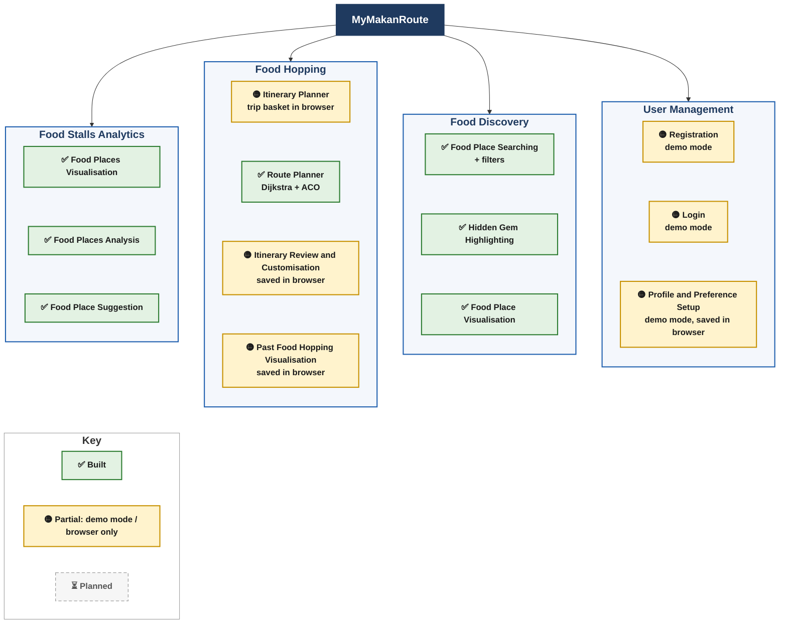

# MyMakanRoute: Module Diagram and Status

The module diagram from the project proposal, with what is built today (5 Nov 2026, branch `feature/feasibility-core`). The 4 modules and 13 submodules are fixed by the proposal and are not renamed here. Filtering (halal, budget, cuisine, dietary, opening hours) is not a module: it is part of Food Discovery (search filters) and Food Hopping (picking places from filtered results).

Status key:

- ✅ **Built:** works end to end: backend API (with tests) and web page.
- 🟡 **Partial:** the web screen works, but only in **demo mode** or with data **saved in the browser** (localStorage, the browser's small storage). The backend part is planned for Phase 2B.
- ⏳ **Planned:** not built yet.

**In plain words:** all three Food Discovery submodules, the Route Planner and all three Food Stalls Analytics submodules are built and backed by the API. The User Management submodules and the other three Food Hopping submodules have working web screens, but the data stays in the user's browser until the login (Supabase Auth) and itinerary API are built in Phase 2B. The database tables for that (`profiles`, `preferences`, `itineraries`, `itinerary_stops`) already exist. Nothing is fully ⏳ planned at submodule level; the planned items are listed below the table.

## Evidence per submodule

Test files are in `backend/tests/` (Jest; they run without a database, internet or secrets) and next to the web code (`*.test.jsx`, Vitest).

| Module | Submodule | Status | Backend endpoint | Web page | Tests |
| --- | --- | --- | --- | --- | --- |
| User Management | Registration | 🟡 Demo mode | Planned: `POST /api/auth/register` (2B) | `/register` | `web/src/api/userManagement.test.js` |
| User Management | Login | 🟡 Demo mode | Planned: `POST /api/auth/login`, `/refresh` (2B) | `/login` | `web/src/api/userManagement.test.js` |
| User Management | Profile and Preference Setup | 🟡 Demo mode (preferences become the starting filters on Discover) | Planned (2B) | `/profile` | `web/src/api/userManagement.test.js` |
| Food Discovery | Food Place Searching | ✅ Built (radius search; filters halal, maxPrice, cuisine, dietary, openNow, label) | `GET /api/discovery/places` | `/discover` | `tests/api/discovery.test.js`, `tests/unit/foodDiscoveryModel.test.js`, `foodDiscoveryService.test.js`, `openingHours.test.js`; `web/src/pages/FoodDiscoveryPage.test.jsx` |
| Food Discovery | Hidden Gem Highlighting | ✅ Built (3 labels, gems ranked first) | `label` in `GET /api/discovery/places` | `/discover` badges | `tests/unit/hiddenGem.test.js`; `web/src/components/LabelBadge.test.jsx` |
| Food Discovery | Food Place Visualisation | ✅ Built (Leaflet map + detail panel) | `GET /api/discovery/places/:id` | `/discover` | `tests/api/discovery.test.js`; `FoodDiscoveryPage.test.jsx` |
| Food Hopping | Itinerary Planner | 🟡 Trip basket kept in the browser | Planned: itinerary API (2B, step 2.12) | `/discover` (add) and `/trip` | `web/src/context/TripBasketContext.test.jsx` |
| Food Hopping | Route Planner | ✅ Built (OSM road graph, Dijkstra time matrix, ACO order, compared with nearest neighbour and brute force) | `POST /api/hopping/route` | `/trip` | `tests/api/hoppingRoute.test.js`, `tests/unit/dijkstra.test.js`, `antColony.test.js`, `travelGraph.test.js`, `buildRoadGraph.test.js`; `web/src/api/foodHopping.test.js`, `ItineraryPlannerPage.test.jsx` |
| Food Hopping | Itinerary Review and Customisation | 🟡 Move up/down, remove, re-plan work; saving is in the browser | Planned (2B, step 2.13) | `/trip` | `ItineraryPlannerPage.test.jsx`, `TripBasketContext.test.jsx` |
| Food Hopping | Past Food Hopping Visualisation | 🟡 Lists trips saved in this browser and draws them on the map | Planned (2B, step 2.14) | `/trips` | No dedicated test yet |
| Food Stalls Analytics | Food Places Visualisation | ✅ Built (totals, by area, by cuisine, label counts, rating vs reviews points) | `GET /api/analytics/overview` | `/analytics` charts | `tests/api/analytics.test.js`, `tests/unit/foodStallsAnalytics.test.js`; `FoodStallsAnalyticsPage.test.jsx` |
| Food Stalls Analytics | Food Places Analysis | ✅ Built (written findings) | `findings` in `/api/analytics/overview` | `/analytics` "Findings" | same as above |
| Food Stalls Analytics | Food Place Suggestion | ✅ Built (top 5 hidden gems) | `suggestions` in `/api/analytics/overview` | `/analytics` | same as above |

Shared foundation (supports all modules, built): settings check (`config.test.js`), database pool and SSL, migrations (`migrate.test.js`, `lockDownMigration.test.js`), 55 SAMPLE places (`seed.test.js`), OSM import (`importOsm.test.js`), validation and error format (`validation.test.js`, `errors.test.js`, `errorHandler.test.js`), landing page (`/`, `HomePage.test.jsx` and the landing component tests).

Size: 277 backend tests (Jest) and 93 web tests (Vitest).

## Planned (not built yet)

| Item | Submodule | Phase |
| --- | --- | --- |
| Real accounts via Supabase Auth, called through `/api/auth/register`, `/login`, `/refresh`; token check middleware | Registration, Login | 2B |
| Profile and preferences stored in the `profiles` / `preferences` tables | Profile and Preference Setup | 2B |
| Itinerary API: create, list, edit, reorder, save, past trips (tables `itineraries`, `itinerary_stops`) | Itinerary Planner, Itinerary Review and Customisation, Past Food Hopping Visualisation | 2B |
| Discovery uses saved preferences from the database as default filters | Food Place Searching | 2B |
| Google Places ratings for the 55 sample places (`npm run import:ratings`) | Hidden Gem Highlighting | step 2.9a |
| Admin-only access to analytics (the `role` column exists; the dashboard is open to all for now) | Food Stalls Analytics | later |
| Mobile app (React Native + Expo) | all modules | 2D |

Image for slides: `docs/diagrams/module-status-1.png`, made with mermaid-cli from the diagram above.
