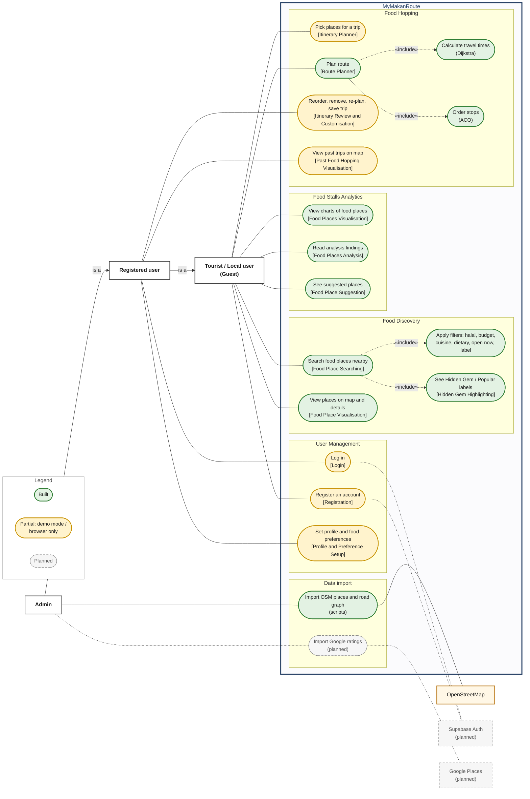

# MyMakanRoute: Use Case Diagram

A **use case diagram** shows who uses the system (the **actors**) and what they can do with it (the **use cases**). The box "MyMakanRoute" is the **system boundary**: everything inside it is part of our system; actors stand outside.

Mermaid (the diagram language used here) has no real UML use case diagram, so it is drawn as a flowchart:

- Actors are on the left (people) and on the right (external systems).
- Use cases are the rounded boxes, grouped by the 4 modules (plus the data import scripts), with the exact submodule name in square brackets.
- **«include»** (dashed arrow with a label) means "this use case always also does that one".
- Solid green border = built. Yellow = partly built (demo mode or saved in the browser only). Grey dashed border with "(planned)" = not built yet.

**In plain words**

- **Guest** (a tourist or local who has not logged in) can search for food places, see the hidden gem labels, view them on the map, pick places for a trip, plan the route and look at the analytics dashboard. In today's web app nothing is locked behind login.
- **Registered user** can do everything a Guest can ("is a" Guest), plus log in, set preferences and keep trips. The diagram shows the intended design: today reorder, save and past trips also work for guests, because nothing is locked behind login yet; login-only access is planned with Supabase Auth. Today these run in **demo mode**: the account, preferences and saved trips live only in this browser (localStorage). Real accounts through Supabase Auth and the itinerary API come in Phase 2B.
- **Admin** is a registered user with `role = 'admin'` in the `profiles` table. The role column exists, but no admin-only screen is built yet, so the analytics dashboard is open to everyone (drawn as Guest use cases). Admin-only analytics is a possible later step. The import scripts (`npm run import:osm`, `npm run build:road-graph`) are run by the developer/admin from the command line.
- **Search food places** always includes **Apply filters** and the **hidden gem labelling**. **Plan route** always includes **Calculate travel times (Dijkstra)** and **Order stops (ACO)**.
- **OpenStreetMap** provides the place data and the road graph (through the import scripts) and the web map's background tiles. **Supabase Auth** and **Google Places** are planned external systems.

## Use case table

| Use case | Actor | Submodule | Status | Where |
| --- | --- | --- | --- | --- |
| Register an account | Guest | Registration | Demo mode | Web `/register` (browser only). API `POST /api/auth/register` planned (2B) |
| Log in | Registered user | Login | Demo mode | Web `/login` (browser only, password not checked). API `POST /api/auth/login`, `/refresh` planned (2B) |
| Set profile and food preferences | Registered user | Profile and Preference Setup | Demo mode | Web `/profile`; preferences saved in the browser and used as starting filters on `/discover`. API planned (2B) |
| Search food places nearby | Guest | Food Place Searching | Built | `GET /api/discovery/places`; web `/discover` |
| Apply filters (halal, budget, cuisine, dietary, open now, label) | Guest | Food Place Searching (filtering inside Food Discovery) | Built | Query parameters of `GET /api/discovery/places`; filter panel on `/discover` |
| See Hidden Gem / Popular labels | Guest | Hidden Gem Highlighting | Built | `label` field in `/api/discovery/places`; badges and gems-first ranking on `/discover` |
| View places on map and details | Guest | Food Place Visualisation | Built | `GET /api/discovery/places/:id`; Leaflet map and detail panel on `/discover` |
| Pick places for a trip | Guest | Itinerary Planner | Partial (browser only) | Trip basket on `/discover` and `/trip` (kept in the browser). Itinerary API planned (2B) |
| Plan route | Guest | Route Planner | Built | `POST /api/hopping/route`; map and leg list on `/trip` |
| Calculate travel times (Dijkstra) | (included) | Route Planner | Built | `food-hopping/dijkstra.js`, `travelGraph.js` |
| Order stops (ACO) | (included) | Route Planner | Built | `food-hopping/antColony.js`; comparison with nearest neighbour and brute force in `routeBaselines.js` |
| Reorder, remove, re-plan, save trip | Registered user | Itinerary Review and Customisation | Partial (browser only) | Move up/down, remove, re-plan, save on `/trip`; saved in the browser. API planned (2B) |
| View past trips on map | Registered user | Past Food Hopping Visualisation | Partial (browser only) | Web `/trips` (trips saved in this browser). API planned (2B) |
| View charts of food places | Guest | Food Places Visualisation | Built | `GET /api/analytics/overview`; charts on `/analytics` |
| Read analysis findings | Guest (admin-only possible later) | Food Places Analysis | Built | `findings` in `/api/analytics/overview`; "Findings" on `/analytics` |
| See suggested places | Guest (admin-only possible later) | Food Place Suggestion | Built | `suggestions` in `/api/analytics/overview`; `/analytics` |
| Import OSM places and road graph | Admin / developer | (shared data foundation) | Built | `npm run import:osm`, `npm run build:road-graph` |
| Import Google ratings | Admin / developer | Hidden Gem Highlighting (data) | Planned (step 2.9a) | `npm run import:ratings` (not built) |

Image for slides: `docs/diagrams/use-case-1.png`, made with mermaid-cli from the diagram above.
